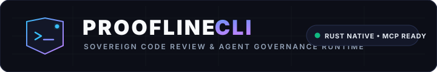
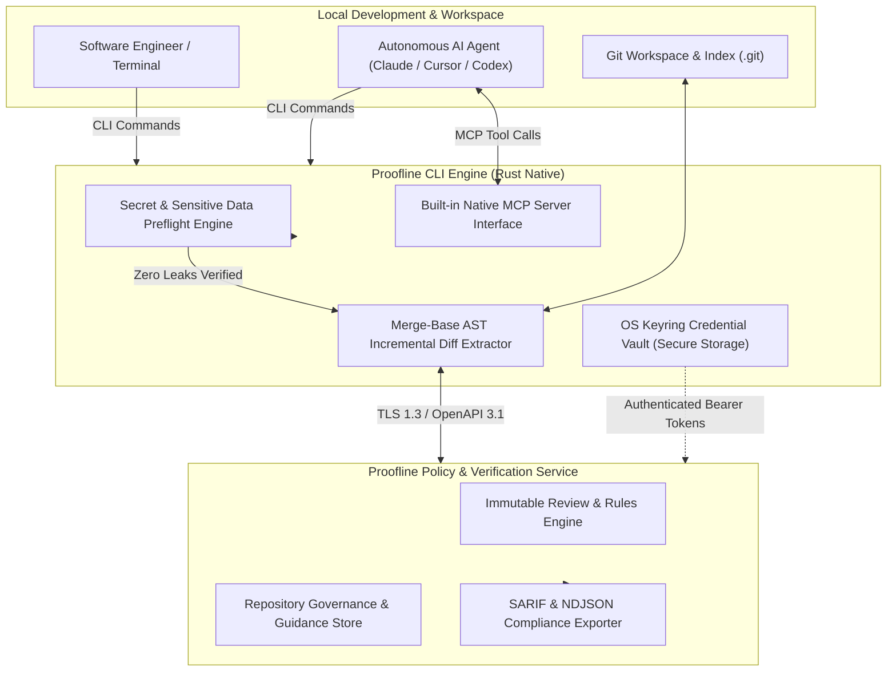

<p align="center">
  
</p>

<p align="center">
  <strong>Sovereign Code Review, Security Preflight &amp; Autonomous Agent Governance Engine</strong>
</p>

<p align="center">
  <a href="https://www.linkedin.com/in/akashjadon"></a>
  <a href="https://github.com/akashjadon04"></a>
  
  
  
</p>

---

## ⚡ Executive Summary

As frontier AI coding agents (Claude Code, Cursor, OpenAI Codex, Google Gemini CLI) autonomously author software, human review queues are overwhelmed with high-volume, low-context pull requests. Traditional static analyzers lack awareness of conversational intent, while pure LLM reviewers suffer from hallucinated rule checks and leaky secrets.

**Proofline CLI** (`proofline`) is an enterprise-grade, memory-safe command-line runtime engineered in **Rust**. It enforces deterministic pre-commit safety guardrails, AST-aware incremental diff reviews against upstream merge bases, secret leakage prevention, and native **Model Context Protocol (MCP)** tool integration.

Proofline embeds directly into both developer terminal workflows and autonomous agent loops, allowing agents to self-inspect their proposed patches, pull organization guidance, and query fix prompts before pushing to shared branches.

---

## 🏛️ System Architecture



---

## 💎 Core Technical Capabilities

| Capability | Specification | Architectural Advantage |
| :--- | :--- | :--- |
| **Rust Native Speed** | Zero-allocation binary compiled with Rust 2024 | Instant execution in pre-commit hooks (<15ms overhead) without runtime startup delay. |
| **Secret Preflight Gate** | Multi-pattern heuristic entropy scanning | Blocks accidental leakage of API tokens, private keys, and passwords before network dispatch. |
| **Merge-Base Diffing** | Deterministic `git merge-base` calculation | Reviews only actual branch divergence, eliminating noise from unrelated upstream commits. |
| **Agent MCP Integration** | Auto-registers into Claude Code, Cursor, Codex, Gemini | Exposes review tools directly to agent context so agents can self-audit before committing. |
| **Immutable Finding History** | Deterministic finding IDs with replay hashes | Ensures all findings and remediation suggestions are cryptographically auditable. |
| **Enterprise Export** | NDJSON and RFC 4180 CSV streaming | Streams review analytics, spend metrics, and finding outcomes directly to data lakes. |

---

## 📡 Command-Line Interface Reference

### 1. Perform Code Review
Review specific staged files or whole branch deltas:

```bash
# Review only local changes in a specific file
proofline review --path src/main.rs

# Review all staged modifications
proofline review --staged

# Review newly created untracked files
proofline review --path src/new_module.rs --include-untracked
```

### 2. Autonomous Agent MCP Installation
One-click integration for agentic coding tools:

```bash
# Install MCP server into Claude Code without interactive prompts
proofline agent install claude-code --yes

# Install MCP server into Cursor or Codex
proofline agent install cursor --yes
```

### 3. Historical Audit & Remediation
Inspect past findings and retrieve exact remediation guidance:

```bash
# Fetch immutable history for a specific PR
proofline history --repo akashjadon04/cli --pr 7

# Request a targeted fix prompt for an identified issue
proofline fix-prompt FINDING_ID
```

### 4. Telemetry & Compliance Export
Stream analytical datasets for compliance archiving:

```bash
proofline export reviews \
  --from 2026-10-01T00:00:00Z \
  --to 2026-11-01T00:00:00Z \
  --format csv > audit_export.csv
```

---

## 🚀 Installation & Build

### 1. Build from Source (Rust)

```bash
# Clone the repository
git clone https://github.com/akashjadon04/cli.git
cd cli

# Build optimized release binary
cargo build --locked --release

# Install executable into user bin path
cargo install --path .
```

### 2. Verify Code Quality

```bash
# Format verification
cargo fmt --check

# Strict Clippy linter
cargo clippy --locked --all-targets -- -D warnings

# Execute test suite
cargo test --locked
```

---

## 📂 Repository Layout

```
cli/
├── assets/
│   └── proofline-cli-banner.svg     # Vector branding header
├── Cargo.toml                       # Package manifest & dependency trees
├── openapi.public.json              # Contract specification for Review API
├── src/                             # Rust native implementation
│   ├── main.rs                      # CLI entrypoint & subcommands
│   ├── agent.rs                     # MCP registration for Claude/Cursor
│   ├── preflight.rs                 # Secret scanning & hygiene filters
│   ├── git.rs                       # Merge-base calculation & diff parsing
│   ├── api.rs                       # Authenticated HTTP client & retry logic
│   └── sarif.rs                     # Static analysis SARIF 2.1.0 generator
└── tests/                           # Integration test suites & mock fixtures
```

---

## 👨‍💻 Architected & Developed By

<p align="left">
  <strong>Akash Jadon</strong><br/>
  Principal Systems &amp; Autonomous AI Architect<br/>
  💼 LinkedIn: <a href="https://www.linkedin.com/in/akashjadon">https://www.linkedin.com/in/akashjadon</a><br/>
  🐙 GitHub: <a href="https://github.com/akashjadon04">https://github.com/akashjadon04</a>
</p>

---

## 📄 License

Distributed under the Apache License, Version 2.0. See [LICENSE](LICENSE) for complete terms.
